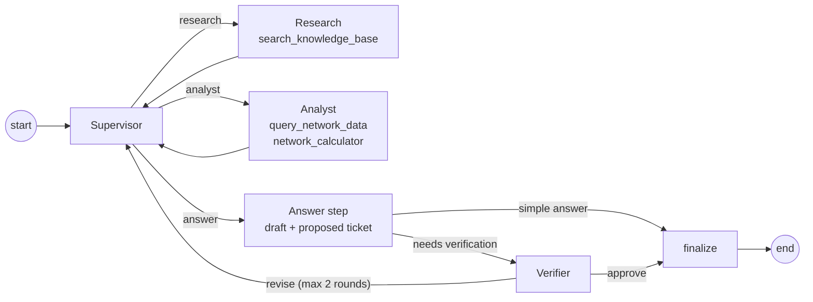

# NOC Copilot

A multi-agent assistant that helps network operations (NOC) engineers at a fictional operator, **NordTel**, diagnose 5G cell degradations. It combines troubleshooting runbooks (RAG), read-only access to drive-test data, exact calculations, and a Verifier that checks diagnoses before they reach the engineer. Tickets are only proposed: a human approves them.

## How to run
Requirements: Python 3.11+, Node 18+, an OpenAI or Anthropic API key. Commands start from the repository root.

```bash
cp .env.example .env                        # set LLM_PROVIDER and OPENAI_API_KEY or ANTHROPIC_API_KEY
pip install -r backend/requirements.txt     # LangChain/LangGraph 1.x (use a fresh venv)
(cd backend && uvicorn app.main:app --reload)   # terminal 1: API on :8000, creates data/nordtel.db on first start
(cd frontend && npm install && npm run dev)     # terminal 2: UI on http://localhost:5173
(cd backend && python -m pytest -q)             # tests, no API key needed
```

## Technologies
LangGraph (agent graph, `MemorySaver` checkpointer) · langchain-core (`bind_tools`, structured output with Pydantic) · OpenAI `gpt-4o-mini` or Anthropic `claude-haiku-5-5` · BM25 (`rank_bm25`) · SQLite · FastAPI · React + TypeScript (Vite) · pytest.

## Architecture


The React UI sends `{session_id, message}` to `POST /api/chat`. The API runs one graph turn with `thread_id = session_id`, so the checkpointer keeps the conversation. The response carries the answer, sources, the agent trace (shown as "How I got this"), the Verifier's verdict and an optional proposed ticket. Approving the ticket calls `POST /api/tickets`, the only code path that creates one.

Code: `backend/app/` (`graph.py` wiring, `agents/`, `tools/`, `rag/`, `domain.py` with all thresholds and root causes), `knowledge_base/` (8 documents), `data/` (synthetic data, see [data/README.md](data/README.md)), `eval/` (see [eval/README.md](eval/README.md)), `frontend/`.

## Agents
| Agent | Responsibility | Tools |
|---|---|---|
| Supervisor | Decides the next step (`research`, `analyst` or `answer`) with a reason and a self-contained task, and whether the answer needs verification. | none |
| Research | Searches the knowledge base; returns rules and severities with cited sources. | `search_knowledge_base` |
| Analyst | Queries the drive-test data and runs exact calculations; returns findings with numbers. | `query_network_data`, `network_calculator` |
| Answer step | Writes the answer from the findings only; for a diagnosis, sets the root cause and proposes a ticket. | none |
| Verifier | Checks the draft against the raw tool results and retrieved sections; approves or sends specific feedback back to the Supervisor. | none |

Each agent is bound only to its own tools. No agent can create a ticket or write data.

## Tools and RAG
- **`search_knowledge_base(query, k)`**: BM25 over the 8 Markdown documents, one chunk per H2 section (53 chunks), each labelled `file.md > Section`. BM25 fits a tiny corpus full of exact terms (RSRP, PCI mod 30, RC6, P2): no embedding key, deterministic, easy to evaluate. Only sections actually retrieved in the turn can appear as sources in the UI.
- **`query_network_data(sql)`**: one read-only `SELECT` on tables `cells` and `measurements` (read-only connection, single statement, 2 s time limit, 50 rows max). Errors are returned to the agent with the schema.
- **`network_calculator(operation, ...)`**: distance (overshooting check), PCI mod 30 conflict, KPI classification. The LLM never does arithmetic itself.

## How agents coordinate
The workflow is not hard-coded. The Supervisor is an LLM with structured output that decides at every step:
- **Which agent:** concept questions go to Research, data questions to the Analyst, diagnoses to both.
- **Which tool:** Research and the Analyst each run a small tool loop and choose their own tools and arguments (e.g. SQL first, then the calculator on the result).
- **Whether RAG is needed:** pure data questions never touch the knowledge base.
- **Whether to review:** diagnoses, numbers and severities go to the Verifier; simple definitions skip it. A `revise` verdict goes back to the Supervisor, which gathers missing evidence or asks for a rewrite. After 2 rounds the answer is shown with a caveat and the ticket is withheld.
- **Guards:** at most 8 Supervisor steps, tool errors returned to the agent, invalid structured outputs retried once then a safe fallback.
- **Conversation state:** messages persist per session; follow-ups like "and what severity should that be?" work.

## Example questions
| Shows | Question |
|---|---|
| RAG | What is PCI mod 30 and why does it matter in 5G NR? |
| RAG | Which severity applies when one cell has been below 600 Mbps for 45 minutes? |
| Tool use | What is the average number of scheduled RBs on route R4? (SQL) |
| Tool use | Do PCI 205 and PCI 145 have a PCI mod 30 conflict? (calculator) |
| Multi-agent | Diagnose route R3 and propose a ticket if needed. (Analyst → Research → Answer → Verifier, ticket card) |
| Multi-agent | Why does throughput dip repeatedly on route R6? Propose a ticket if needed. |
| Conversation | "Diagnose route R3." then "And what severity should that be?" |

## Evaluation
20 golden questions with deterministic metrics, no LLM-as-judge ([eval/README.md](eval/README.md)). Last run on `claude-haiku-5-5`: root cause accuracy 100%, agent selection 85%, tool selection 95%, Verifier approval 86%, average latency 31 s (diagnoses 40 to 80 s). The tests (62, no API key) use a scripted fake LLM to cover routing, revisions, guards, tool permissions, memory and SQL safety.

## Design decisions
- **Supervisor with structured output** instead of a fixed pipeline: routing is dynamic but explainable (the reason is shown in the UI) and testable.
- **Separate writer and Verifier:** the Verifier sees raw tool results, so it can catch invented numbers.
- **Human in the loop:** agents only propose tickets; unverified answers never carry one.
- **Deterministic tools for numbers**, and one source of truth (`domain.py`) for thresholds used by data, tools, prompts and evaluation.

## What I would improve with more time
- **Latency:** a diagnosis is 10 to 20 sequential LLM calls. Run Research and the Analyst in parallel, add a `route_summary` tool for the standard checks, and stream the trace to the UI.
- **Reliability:** the Verifier still rejects some correct diagnoses (e.g. route R2); tune it and run the eval over several models in CI.
- **Retrieval:** hybrid BM25 + embeddings with a reranker once the corpus grows.
- **Production:** persistent checkpointer, authentication and rate limits, only accept tickets the assistant proposed, OpenTelemetry tracing.
- **Data realism:** routes last about 1 minute and there is no busy-cell flag, so some escalation rules cannot be checked from data.
